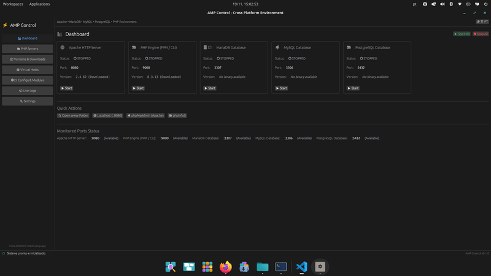

= ⚡ AMP Control (Rust + egui)
:toc: left
:toclevels: 3
:toc-title: Table of Contents
:icons: font
:source-highlighter: highlight.js
:experimental:

https://github.com/kriolos/kriolos-amp[image:https://img.shields.io/badge/GitHub-kriolos%2Fkriolos--amp-blue?logo=github[Official Repository]]
image:https://img.shields.io/badge/license-MIT%20%7C%20Apache--2.0-green[License]
image:https://img.shields.io/badge/rust-2021%20edition-orange?logo=rust[Rust Edition]

A modern, lightweight, and cross-platform control panel for **AMP** development environments (**Apache** + **MariaDB / MySQL / PostgreSQL** + **PHP**), written in **Rust** using **egui** (`eframe`).

Inspired by UwAmp, but reimagined from the ground up as a high-performance **native application** for **Linux**, **Windows**, and **macOS**, eliminating any dependency on Wine or legacy Windows-only APIs.

---

== 🌟 Key Features

=== 📊 Modern & Responsive Dashboard
* **Adaptive fluid layout**:
  ** Dynamic flex-wrap grid (`horizontal_wrapped`) that seamlessly wraps from 3 to 2 or 1 column as the window is resized.
  ** Symmetrical and compact service cards (fixed 240px width with natural vertical height).
* **Real-time service monitoring**:
  ** Live status indicators, process IDs (PID), and active listening ports.
  ** Dynamic port monitoring pill (`PortIndicator`) reflecting currently active services without hardcoded clutter.
  ** Clear visual differentiation between system binaries and downloaded packages: `(Downloaded)` or `(System)`.
* **One-click quick actions**:
  ** Start, stop, or restart individual services or all services simultaneously.
  ** Direct shortcuts to open the `www/` root folder, `phpinfo()`, and local web applications.

=== 🐘 Embedded PHP Development Servers (`php -S`)
* Create, manage, and run lightweight, standalone PHP development web servers without requiring Apache.
* Individual configuration per instance: custom port, document root, and active PHP binary.
* Seamless auto-save and persistence in `config.json`.

=== 📦 Package Manager & Version Catalog
* Integrated extensible catalog (`assets/versions.json`) with pre-configured packages.
* Strict classification between pre-compiled **Binaries** (`Binary`) and **Source Code** (`Source`).
* Built-in support for bot-protected external links (`external_link: true`) opening directly in the user's default browser (e.g. Oracle MySQL, Microsoft Visual C++ Redistributable).
* Asynchronous background downloader with:
  ** Smooth progress bar displaying percentage and transferred size in MB.
  ** Comprehensive error handling and diagnostics displaying the **exact URL** on failure.
  ** Automatic extraction for `.zip`, `.tar.gz`, and `.tar.xz` archives into dedicated binary directories.
* One-click option to force re-download of already installed packages.

=== 🌐 Complete Internationalization (i18n)
* Built-in support for multiple languages (**English `en-US`** and **Portuguese `pt-PT`**).
* Instant runtime language switching directly from the UI without restarting.
* **Decoupled architecture**: zero hardcoded natural language strings in `amp-core`; all errors and events are transmitted via structured enums (`ServiceError`, `LogEvent`).

=== 📜 Real-time System Logs & Status Bar
* Persistent bottom status bar showing quick action confirmations, error indicators, and a direct shortcut to logs.
* Live log stream viewer with auto-scroll, color-coded severity levels, and real-time text filter.

=== 🎨 Customization & Theming
* Native support for both **Dark Mode** and **Light Mode**.
* Non-destructive, human-readable configuration entirely stored in `config.json` with reset-to-defaults capability.

---

== 📦 Embedded & Self-Contained Edition (Architecture & Vision)

A primary design goal is the ability to generate an optional **self-contained, zero-dependency distribution** where all core runtimes are embedded directly into the application:

* **Static PHP Runtime**:
  ** Built using https://static-php.dev/[Static PHP CLI (SPC)] or https://github.com/shivammathur/php-builder[PHP Builder] (supporting modern versions including PHP 8.3 and static PHP 8.5+).
  ** Bundled with popular extensions pre-compiled (`sqlite3`, `pdo_sqlite`, `curl`, `mbstring`, `openssl`, etc.).
  ** Powered by https://micro.static-php.dev/[Micro SAPI for PHP] and **MicroSFX**, serving as the glue between PHP code and the interpreter within a single binary or lightweight package.
* **Autocontained Database Options**:
  ** Embedded **SQLite** support with zero daemon overhead.
  ** Optional bundled lightweight **MariaDB** / **MySQL** or in-process SQL engines.
* **Key Advantages**:
  ** **100% Portable**: Runs directly from any directory or USB stick without installer or registry clutter.
  ** **Air-Gapped Ready**: Operates seamlessly without internet access once packaged.

=== References & Tooling
* https://static-php.dev/[Static PHP CLI (SPC)] - Single-command static PHP build tool.
* https://micro.static-php.dev/[Micro SAPI] - Micro self-executable SAPI for PHP applications.
* https://github.com/crazywhalecc/static-php-cli[SPC Releases] - Pre-built static CLI binaries across `linux-x86_64`, `linux-aarch64`, `macos-x86_64`, `macos-aarch64`, and `windows-x64`.
* https://github.com/shivammathur/php-builder[PHP Builder] - Automated builds for portable PHP distributions.

---

== 🔄 Comparison with Alternatives

[cols="2,2,2,3", options="header"]
|===
| Solution | Platforms | Tech Stack | Key Differences vs. AMP Control

| **Laragon**
| Windows only
| Delphi / Pascal
| Fast and popular on Windows, but lacks cross-platform Linux/macOS support.

| **XAMPP / WAMP**
| Windows, Linux, macOS
| C / C++ / Qt / Web wrappers
| Heavy resource footprint, traditional installer-centric design, and legacy desktop UI.

| **EasyPHP / UwAmp**
| Windows only
| Delphi / Windows APIs
| Legacy Windows stacks requiring Wine or emulation on non-Windows platforms.

| **⚡ AMP Control**
| **Linux, Windows, macOS**
| **Rust + egui**
| Native, cross-platform, minimal RAM footprint (<20MB), modular architecture with embedded/static PHP readiness.
|===

---

== 🗺️ Extended Feature Roadmap

* [ ] **Local SSL / HTTPS Automation**: One-click local root CA and trusted certificate generation via https://github.com/FiloSottile/mkcert[mkcert].
* [ ] **Automated Virtual Hosts & `.test` Domains**: Seamless local `.test` hostname mapping with hosts file management.
* [ ] **Concurrent Multi-PHP Support**: Run multiple distinct PHP versions across independent projects simultaneously via dedicated `php -S` instances.
* [ ] **Mail Catcher (Mailpit / Mailhog Integration)**: Built-in local SMTP mock server to intercept and preview outgoing PHP emails.
* [ ] **Smart Port Conflict Diagnostic**: Automatic detection of blocking processes (PID and name) with single-click resolution.
* [ ] **Live System Metrics**: Real-time CPU and memory telemetry for running services powered by `egui_plot`.
* [ ] **Stack Portability Profiles**: Export and import project environments via portable `amp-stack.json` manifests.

---

== 🏗️ Project Architecture

[source,text]
----
amp-control/
├── Cargo.toml                 # Cargo workspace configuration
├── config.json                # User preferences, port definitions, and server instances
├── assets/
│   └── versions.json          # Pre-configured package catalog & download manifests
├── crates/
│   ├── amp-core/              # Backend core engine & business logic
│   │   ├── src/
│   │   │   ├── models.rs          # Data models, domain types, typed errors & events
│   │   │   ├── package_manager.rs # Async downloader, checksum & archive extractor
│   │   │   ├── port_checker.rs    # TCP port probe & conflict detection
│   │   │   ├── service_manager.rs # Process lifecycle management & supervision
│   │   │   └── template_engine.rs # Portable configuration template substitutions
│   └── amp-gui/               # Native graphical interface built with egui / eframe
│       ├── src/
│       │   ├── app.rs             # Application state, action dispatch & event loop
│       │   ├── i18n.rs            # Multi-language translation engine
│       │   ├── main.rs            # Native entrypoint & Tokio runtime setup
│       │   ├── components/        # Reusable UI widgets
│       │   │   ├── mod.rs
│       │   │   ├── port_indicator.rs  # Dynamic port indicator widget
│       │   │   └── service_card.rs    # Modular service card component
│       │   └── views/             # Modular tab views
│       │       ├── configs.rs         # Configuration file editor
│       │       ├── dashboard.rs       # Main services grid & quick actions
│       │       ├── logs.rs            # Real-time searchable log viewer
│       │       ├── php_servers.rs     # Embedded PHP server instances manager
│       │       ├── settings.rs        # App settings (theme, language, directories)
│       │       ├── versions.rs        # Package manager & version switcher
│       │       └── vhosts.rs          # Virtual host management
└── www/                       # Default web root directory
    ├── index.php
    └── phpinfo.php
----

---

== 🚀 Getting Started

=== Prerequisites
* **Rust**: Recent stable toolchain (1.80+) installed via https://rustup.rs[rustup].

=== Run in Development Mode
[source,bash]
----
cd amp-control
cargo run -p amp-gui
----

=== Build Optimized Release Binary
[source,bash]
----
cargo build --release -p amp-gui
./target/release/amp-gui
----

=== Run Test Suite
[source,bash]
----
cargo test
----

---

== 📄 License

Distributed under the **MIT** or **Apache-2.0** license.
